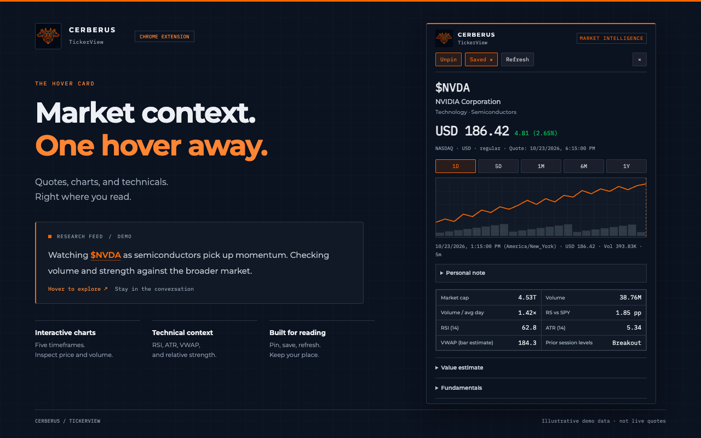
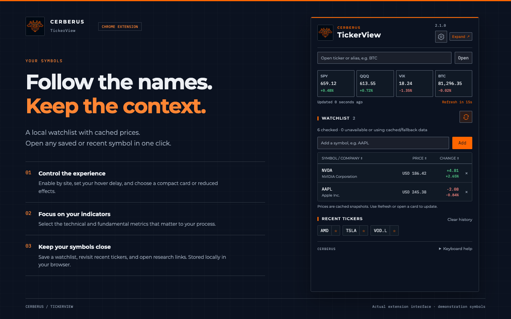
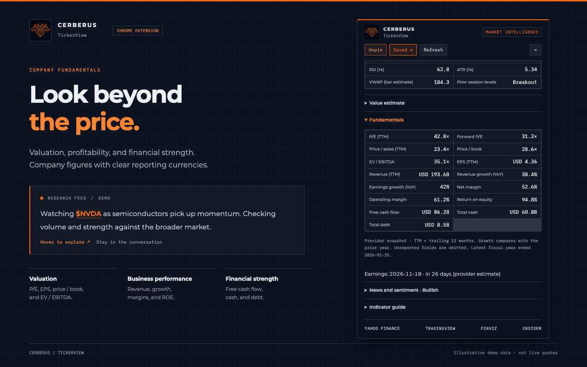
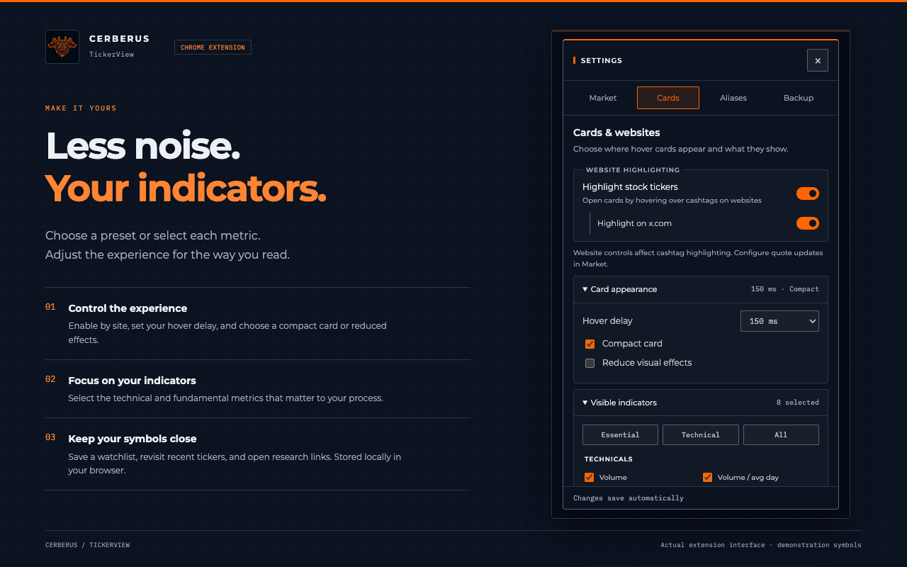
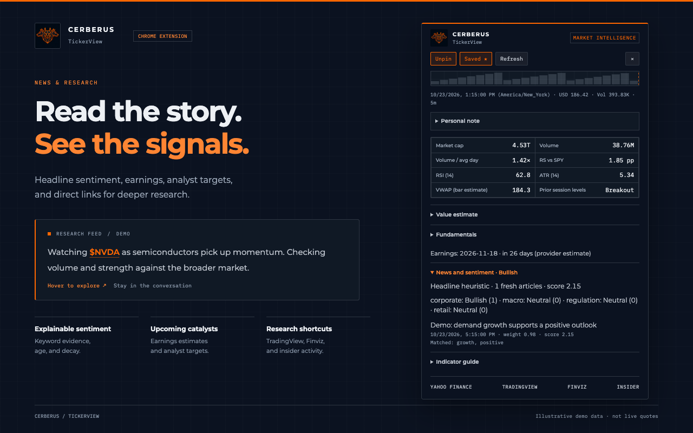
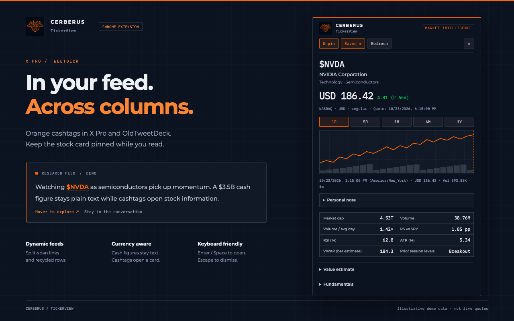
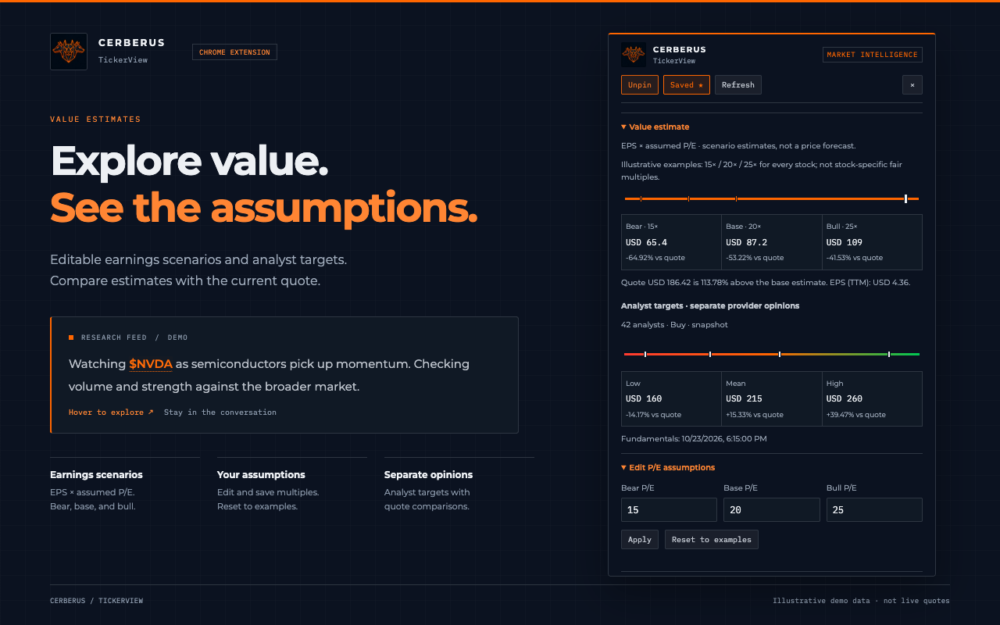

# TickerView

TickerView is a Manifest V3 Chrome extension that highlights stock cashtags on supported finance and social sites. Hover over `$AAPL`, or focus it and press Enter or Space, to open a market-data card.

## Screenshots















These images show the actual extension interface with illustrative demo data, not live quotes.

## Branding

The extension uses the original Cerberus Terminal logo, with Chrome toolbar and extension icons at 16, 32, 48, and 128 pixels. Its popup and stock card follow the Terminal's navy/silver surfaces, `#FF6600` accent, compact borders, Montserrat headings, and IBM Plex Mono data typography. Shared tokens live in `brand.css` and are scoped to extension surfaces.

Logo and font assets come from `cerberus_terminal/web/assets/`; palette tokens follow its `zzzz_cerberus.css` theme. Fonts are bundled locally and loaded on use, with their SIL Open Font License files under `fonts/`. No external font service is used.

## Install

1. Download or clone this repository.
2. Open `chrome://extensions` and enable **Developer mode**.
3. Choose **Load unpacked** and select this folder.
4. Open a supported site. After an extension update, reload the extension and refresh existing pages.

**No Node runtime, npm install, build step, account, or server is required to use the extension.** Chrome directly loads the JavaScript, HTML, and CSS files.

## Features

- **Market overview:** SPY, QQQ, VIX (`^VIX`), and BTC (`BTC-USD`) quotes sit above the watchlist. With auto-refresh off, opening the window requests only these four symbols using the shared quote cache; clicking a tile opens its card without saving it. Refresh updates the overview and watchlist together through a shared three-request queue.
- **Header sorting and freshness:** click Symbol, Price, or Change to toggle sort direction; Change sorts by daily percentage, Price by numeric quote-currency price. Missing values remain last. The gear menu retains saved-order/company sorting. “Updated … ago” uses the oldest available source retrieval among displayed quotes, separately from quote timestamps shown in tooltips. Cached/failed and missing quotes are identified. **Settings → Market** configures auto-refresh (enabled by default at 15 seconds; choose 15/30 seconds or 1/2/5 minutes, or switch it off). A live countdown shows the next update; hidden windows pause and resume without overlapping refreshes. The circular-arrow button refreshes immediately and spins while loading. Automatic dashboard quote-cache freshness follows the selected interval; manual refresh bypasses fresh cache entries while retaining request coalescing and failure cooldowns.
- **Window sizing:** the first launcher fits its contents instead of filling the screen. Manual resizing is remembered across reopenings. Use the header Fit button or **Settings → Market → Height mode** to choose Remember my size, Fit to content, or Full height. Sizes are constrained to the available display; settings and stock cards do not trigger automatic shrinkage while open.

- **Market-first window:** search, an aligned Symbol/company / Price / Change watchlist table (daily amount and percentage), and recent tickers stay on the main screen. Open the header gear for four clear tabs: Market (auto-refresh, window size, sorting), Cards (website highlighting and card appearance/indicators), Aliases, and Backup. The Market tab opens first with a visible Auto-refresh switch, On/Off status, and interval selector; click “Auto off · Enable” on the main screen to go straight to it. Settings use a keyboard-accessible dialog with Escape dismissal and focus restoration.

- **Export / import:** download a versioned JSON backup of settings (including per-site controls and indicator choices), watchlist, recents, sort order, custom aliases, saved notes, and valuation assumptions. Open **Settings (gear) → Backup** in the extension window, choose a JSON file, review the preview, then click **Import backup**. **Merge** keeps local-only symbols and entries; imported aliases, notes, and assumptions win conflicts. Settings, sort order, and market-window preferences are replaced in either mode. **Replace** restores the file's lists/maps, removing entries absent from the file. Combined saved-data limits are checked before writing; recent history keeps the first 12 symbols, with local history first when merging. Files must use TickerView's backup format and be at most 2 MB. Backup validation and storage writes are local; restoring enabled auto-refresh resumes quote requests while visible; imported alias targets are validated as literal Yahoo symbols and checked by the provider when used. Quotes, caches, note revisions, machine-specific window bounds, and Chrome-managed keyboard shortcuts are excluded. Earlier backups without market-window preferences restore the default 15-second auto-refresh and remembered-sizing preferences. Imported notes get new revisions so existing drafts can detect conflicts.

- **Quick search:** open a ticker or alias directly from the extension window without adding it to your watchlist. `Alt+Shift+T` opens/focuses search; change the shortcut at `chrome://extensions/shortcuts`. Reusing the window preserves its state and prompts before leaving an unsaved note.
- **Ticker aliases:** built-ins map `VIX → ^VIX`, `SPX / SP500 → ^GSPC`, `DJI → ^DJI`, `IXIC → ^IXIC`, `RUT → ^RUT`, `BTC / BTCUSD → BTC-USD`, and `ETH / ETHUSD → ETH-USD`. Inputs ignore case and an optional `$`. Search, manual watchlist additions, and cashtags use the same dictionary. Page text and native links stay intact. **Settings (gear) → Aliases** lets you save up to 100 provider-verified custom mappings, override built-ins, delete overrides, or reset all custom mappings. Targets are literal Yahoo symbols; aliases never chain. Canonical saved symbols do not change when you edit aliases. Existing watchlist/recent aliases are canonicalized once on upgrade; legacy snapshots and valuation assumptions are retained under their existing keys.
- **Watchlist controls:** Refresh updates overview and saved quotes with at most three concurrent requests, progress, and per-row failure/stale labels. Automatic dashboard updates use the selected interval as their quote-cache lifetime; manual updates request fresh quotes. Watchlist-only symbols remain cached on opening unless auto-refresh is enabled. Sort by headers or use saved-order/company choices under the gear menu, with missing values last. Sort preference is local and does not reorder saved membership.
- **Personal notes:** each card has one plain-text note, an explicit Save button, and a 4,000-character limit. Store notes for up to 100 canonical symbols independently of watchlist membership. Save an empty note to delete it. Drafts survive data refreshes and timeframe changes; closing or switching cards offers Save, Discard, or Cancel. Concurrent saved changes preserve your draft and offer Reload or explicit Overwrite. Closing the browser window uses Chrome's native unsaved-change prompt.

- **Resizable window:** clicking the toolbar icon opens the remembered window size, or fits its contents on first use, with original site controls preserved. Full height remains an option in the gear menu. This avoids Chrome’s 600-pixel toolbar-popup height limit.
- **Value estimates:** bear/base/bull prices use trailing EPS × editable P/E assumptions, with differences from the current quote. The initial 15× / 20× / 25× multiples are illustrative examples for every stock, not stock-specific fair values or price forecasts. Save assumptions locally for up to 100 stocks, or reset to examples. Analyst targets appear separately. Negative/missing EPS, unverified instrument types, and currency mismatches explain why the model is unavailable; cached/older data is identified.
- **Progressive loading:** quote and intraday chart appear independently of fundamentals, news, and benchmarks. Optional provider failures leave the rest of the card usable.
- **Card controls:** Pin/Unpin, Save, Refresh, Close, and Escape. A pinned card stays in place while the page scrolls. Visible cards refresh every minute; refresh pauses in hidden tabs.
- **Interactive charts:** 1D, 5D, 1M, 6M, and 1Y ranges, aligned volume bars, pointer crosshair, timestamps, and prices. Focus the chart and use Left/Right to inspect points.
- **Context:** currency, exchange, session, quote timestamp, stale-data labels, and retrieval times for individual sources. Extended prices are explicitly labeled profile snapshots.
- **Indicators:** RSI, Wilder ATR, ATR %, estimated VWAP and distance, 50/200-day moving averages, distance to 200 DMA, Z-score, Bollinger position, ADR, session gap, prior-session breakout/breakdown, volume, and volume/full-day-average ratio. Fundamentals include market cap, short float, days to cover, earnings radar, and analyst target range.
- **Relative strength:** stock return minus SPY or sector ETF return, shown in percentage points. Comparisons require matching exchange-local market dates.
- **Explainable news sentiment:** headlines, links, publication dates, matched words, decaying weights, category scores, and overall verdict. Articles older than 48 hours do not contribute. This is a keyword heuristic, not a prediction or language model.
- **Settings dialog:** the header gear opens Market, Cards, Aliases, and Backup tabs. Market shows the auto-refresh switch and interval immediately. Cards groups website highlighting, appearance, and Essential / Technical / All indicator presets with a live selection count and Technicals / Fundamentals groups. Changes save automatically and apply to already-open supported pages.
- **Local watchlist and recents:** save up to 100 symbols and view the last 12 opened symbols. Watchlist rows show company names and cached quotes. Overview symbols also update matching watchlist rows when fetched; other saved symbols refresh on request or when auto-refresh is enabled. Click a saved or recent ticker to open its card inside the popup. New manual entries resolve aliases and are verified against provider chart data before saving. Save a recent symbol with its star, remove watchlist rows, or clear recent history. Existing currency false positives are cleaned on upgrade.
- **Symbol mapping:** aliases above resolve to Yahoo symbols. US share classes such as `$BRK.B` map to `BRK-B`; exchange suffixes such as `$VOD.L` and `$7203.T` are preserved. Unsupported symbols return an error. No automatic exchange guessing is performed.
- **Accessibility:** focusable highlights, native buttons/details, keyboard chart inspection, visible focus states, and reduced-motion support.

Automatic scanning runs in top-level pages on X/Twitter (including X Pro and OldTweetDeck at `/i/tweetdeck`), Reddit, Yahoo Finance, Stocktwits, Seeking Alpha, Investing.com, TradingView, MarketWatch, Bloomberg, CNBC, WSJ, Reuters, Benzinga, Motley Fool, and Finviz. It does not run on arbitrary websites or inside editable fields, code blocks, or embedded frames.

## Performance and data behavior

DOM changes enter a deduplicated queue. Scanning yields after at most 250 nodes or approximately 6 ms of JavaScript work, with a pause between chunks, to keep large feeds responsive. Text updates are observed as well as newly added content. Native cashtag links are recognized across child spans, including OldTweetDeck’s separate dollar-sign and symbol nodes. Links keep their original markup and destinations when scanning is disabled. Recycled column rows and replaced page bodies are observed, and pinned cards stay open during column scrolling.

Requests for the same resource share one promise across tabs. Cache lifetimes are:

| Resource | Fresh lifetime |
| --- | --- |
| Quote / intraday, 1D / 5D charts, benchmarks | 60 seconds |
| Daily history and longer chart ranges | 6 hours |
| News / search metadata | 10 minutes |
| Company profile / fundamentals | 6 hours |

Daily indicators reuse cached history and rebuild the current regular-session candle from fresh intraday bars when available. The volume ratio excludes the current partial session from the prior 50-session baseline. VWAP is estimated from five-minute closing prices and volume rather than tick data.

The persistent resource cache is limited to 80 entries and an estimated 2 MB of serialized data. It survives worker restarts, debounces writes, and evicts old entries. Requests time out after seven seconds. Failed resources have a 20-second retry cooldown. Cached data up to seven days old may be returned during an outage with a stale label; otherwise the card reports unavailability. Fundamentals are read from the structured quote-summary JSON embedded in Yahoo’s public key-statistics page; this avoids the authenticated summary API. No page scripts are executed, and only parsed fields are cached. Unavailable metrics are listed explicitly instead of filling the card with `N/A` cells.

Yahoo Finance supplies quotes, charts, and news. Fundamentals use Yahoo’s publicly published statistics snapshots, with availability depending on the instrument. Provider names and retrieval times identify fundamental snapshots. These services can rate-limit requests or withhold fields. Chart lines use Cerberus orange for both rising and falling series; quote changes retain directional colors. Quotes are not guaranteed to be real-time, and retrieval time is separate from quote time. Market-session labels use provider trading-period metadata. VWAP uses the last quoted regular session even when premarket metadata has advanced to a new trading day. Previous-close and key-level calculations follow exchange-local dates; benchmarks from another date are omitted.

## Permissions and privacy

- **`storage`:** local settings, per-site disable list, watchlist and sort preference, recent symbols, notes, custom aliases, market overview snapshots/preferences, remembered window bounds, and bounded market-data cache.
- **`activeTab`:** identifies the current site when opening the settings popup.
- **Host permissions:** `query1.finance.yahoo.com` and `query2.finance.yahoo.com` for quotes, charts, and news; `finance.yahoo.com` for public fundamental snapshots.
- **Content scripts:** limited to the sites listed in `manifest.json`.

Requests omit credentials and referrers. Page text and visited page URLs are not sent to the market-data provider. See [Privacy Policy](PRIVACY_POLICY.md).

## Development checks (optional)

Node is used only for developer tests; it is never loaded by Chrome. `node_modules/` and test outputs are ignored by Git.

```sh
npm ci
npm run check
npm test
npm run test:ui
# Recreate the feature images using local demo data:
npm run screenshots
```

The UI suite uses Playwright with a locally installed Google Chrome at the macOS default path. Set `CHROME_PATH` to your Chrome executable on another system. It uses simulated Chrome extension APIs and provider responses to test the content script and popup deterministically, including a 2,000-post feed. Worker integration tests exercise the actual message handler with simulated network responses. These checks do not establish live Yahoo availability or Chrome Web Store approval.

[Changelog](CHANGELOG.md)
